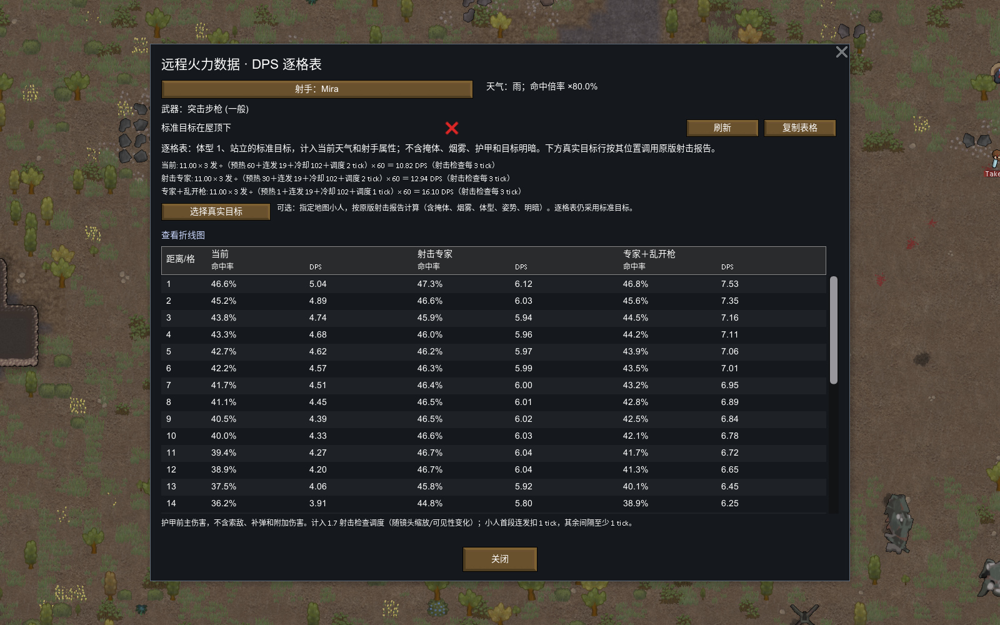
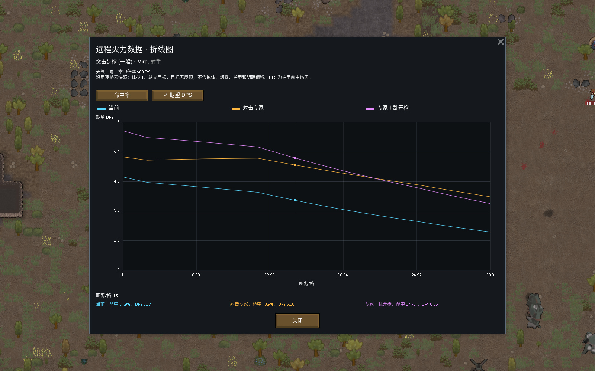

# 远程火力数据 Ranged Firepower Stats

已发布：[Steam 工坊条目 3838056458](https://steamcommunity.com/sharedfiles/filedetails/?id=3838056458)。

RimWorld **1.7** 的远程战斗数据显示工具。作者 **RunningBugs**，packageId 为 **RunningBugs.RangedFirepowerStats**。需要 Harmony；射击专家情景使用 Ideology 的职位定义。由 GPT-6 和 CODEX 制作。

模组增加自己的数据条目、表格和图表入口。武器、小人、炮塔数据集中在独立的 **远程火力数据** 分类。专家推演使用本模组内部的独立属性计算实例，读取实际小人的技能、健康、基因、装备和职位定义。

## 查看数据

1. 选择持枪小人或炮塔，点击 **DPS 逐格表**；信息卡底部也有入口。
2. 比较 **当前／射击专家／专家＋乱开枪** 三种情景的逐格命中率和 DPS。可选择射手、目标屋顶条件和真实目标，支持复制 TSV 表格。
3. 点击 **查看折线图**，在独立窗口中切换命中率与期望 DPS，悬停查看具体格数和数值。

信息卡的逐格表末尾也提供图表超链接。原版射击精度说明中的链接显示 1–55 格的射手精度系数，与该表的数据口径一致。





## 数据口径

共十二项统计：武器最大/期望 DPS 及两种专家参考值，小人当前/专家/专家＋乱开枪 DPS，炮塔最大/武器/射手 DPS，以及两项每单位弹药资源伤害。

使用实际武器的弹丸主伤害、连发数量、两发间隔、预热倍率，及射手的瞄准时间和远程冷却倍率。按 60 tick/秒计算，计入 tick 取整、首段连发更新重叠，以及 1.7 小人随镜头可见性/缩放变化的射击检查间隔。

距离搜索包括合法的小数射程端点。当前天气表使用过渡中的实际命中倍率、双方屋顶规则和天气射程上限。标准逐格表采用体型 1、站立、无遮蔽目标；真实目标行使用原版 ShotReport 的掩体、烟雾、体型、姿势和明暗等数据。

所有 DPS 均为**护甲前主伤害估算**。不含额外伤害、点燃、误打、弹药搬运和索敌等过程。炮塔以平均预热、冷却和连发参数计算持续潜力，不含额外索敌扫描等待。爆炸、散布和特殊弹丸的单目标期望取决于具体机制。

无射手的武器信息采用理想射手精度；选择真实小人后会计入乱开枪的精度惩罚。候选武器预览替换直接装备属性偏移；通过装备事件产生的状态变化仍沿用小人的当前状态。

独立预览实例在原版倍率、精度曲线及下限处理前应用假想职位/特性偏移。当前已具备的职位或特性不会重复叠加。查询不替换小人的职位、特性、装备或游戏共享的 StatWorker，不挂钩全局属性计算方法。生产代码的 Harmony 入口仅用于附加信息卡、Gizmo 和图表链接。

计算依据及原始审计记录见 [docs/source-audit.md](docs/source-audit.md)，当前规格见 [docs/specs/ranged-firepower-stats.md](docs/specs/ranged-firepower-stats.md)。

## 发布图片

所有发布素材均位于 **About/**，为独立一次性地图中实际窗口的截图。拍摄使用原版截图模式；曲线、标签及数值保持原样。

| 文件 | 内容 |
| --- | --- |
| Preview.png | 1024×1024 的 DPS 曲线封面，保留原截图像素 |
| 01-Info-Page.jpg | 信息页及独立数据分类 |
| 02-Range-Table.jpg | 右侧逐格表与下方图表链接 |
| 03-Precision-Link.jpg | 原版射击精度表及超链接 |
| 04-DPS-Comparison.jpg | 当前天气下的三情景逐格比较 |
| 05-DPS-Curves.jpg | DPS 曲线与悬停数据 |
| 06-Accuracy-Curves.jpg | 命中率曲线 |

图库 JPG 保持 1600×1000 原始尺寸。每张发布图片均小于 1 MB，符合 [Steamworks 附加预览图片的大小要求](https://partner.steamgames.com/doc/api/ISteamUGC#AddItemPreviewFile)。素材来源、尺寸和哈希见 [docs/workshop-media.json](docs/workshop-media.json)。

## 安装与工坊目录

源码目录为 **86-RangedFirepowerStats**。构建成品为 `1.7/Assemblies/RangedFirepowerStats.dll`。已整理的上传目录为 **dist/RangedFirepowerStats/**，包含运行程序集、Def、语言、About 图片和许可证。游戏 `Mods/86-RangedFirepowerStats` 链接到此上传目录。

在游戏中启用 **远程火力数据 Ranged Firepower Stats** 和 Harmony。上传目录不包含开发环境、测试入口及构建缓存。

`_PublisherPlus.xml` 是发布文件排除规则的唯一配置，已排除 `dist`、开发环境、测试、工具、源码和缓存；`dist/` 同时进入 Git ignore。规则采用 PublisherPlus 的忽略大小写相对路径前缀语义，不是 glob。`tools/prepare_workshop.py` 读取同一配置并逐文件核对哈希；配置文件本身不会进入上传包。游戏入口当前链接到干净的 `dist`，PublisherPlus 的默认内容与脚本上传内容一致。

## 直接上传

无需打开 RimWorld 界面，使用已登录的 Steam 客户端和游戏自带 Steamworks.NET：

```bash
tools/publish.sh --check   # 本地清单、账号与已有条目所有权检查，不发布
tools/publish.sh           # 创建/更新公开条目，上传描述、封面及六张图库
tools/publish.sh --verify  # 只回读验证服务器上的条目
```

工坊 ID **3838056458** 保存在源码及上传目录的 `About/PublishedFileId.txt`，后续复用同一条目。工具在新建成功后立即保存 ID，更新前核对账号所有权和 RimWorld AppID；上传后等待成功回调并核对服务器标题、描述、公开状态、封面、图库及 Harmony 必需项。已有图库按文件名更新，避免重复添加。发布结果见 [docs/published.json](docs/published.json)。

## 开发与验证

需要 .NET 10 SDK；构建直接引用本机游戏及已安装 Harmony 的程序集，不下载额外 NuGet 包。所有构建缓存位于本项目 `.build/`，Python 工具使用 `.venv/bin/python`。游戏及 Harmony 路径可通过 MSBuild 的 `RimWorldDir`、`HarmonyPath` 参数指定。

```bash
./build.sh
./test.sh native-check --legacy
./test.sh no-ideology --no-ideology
./test.sh media-wide-final --language 'ChineseSimplified (简体中文)' --render --workshop-media
.venv/bin/python Tests/run_game.py media-cover-final --language 'ChineseSimplified (简体中文)' --render --workshop-media --window-size 1024,1024
.venv/bin/python tools/make_preview.py
.venv/bin/python tools/prepare_workshop.py
```

每次测试使用新的用例名，并生成独立的游戏入口、Mods、SaveData、XDG 和临时目录。覆盖真实职位/特性对照、完整连发周期、天气/屋顶、实例参数、合法射程、局部 ShotReport 预览、表图一致、图表链接、独立分类及中文渲染。另验证现有模组属性仍显示且数值不受预览影响，全局属性计算方法没有本模组补丁。结果见 [Tests/results.json](Tests/results.json)。

X11 渲染时，当前 Waylith 会探测尚未初始化的 Wayland 接口；报告在 `engine_notes` 中保留这两条精确匹配的引擎启动消息，其余 ERROR 会导致验证失败。

Def/语言 XML 由 `.venv/bin/python tools/generate_content.py` 重建。发布图片编码工具使用项目环境中的 `pillow==12.0.0`。上传目录可用 `tools/prepare_workshop.py` 重建；已有 PublishedFileId 会保留。

## English

Ranged Firepower Stats adds information entries, per-cell tables and charts for ranged weapons, pawns and turrets. Compare current, shooting specialist and specialist + trigger-happy profiles with current pawn stats and weather. Open charts from the tables or info-card links, switch accuracy/DPS views, inspect per-distance values and copy tables as TSV.

All added entries are grouped under Ranged Firepower Stats. Profile calculations use private stat-worker instances and local report copies. The mod does not change pawn roles, traits or equipment. Values describe sustained primary pre-armor damage under the stated assumptions.

Requires RimWorld 1.7 and Harmony. Specialist profiles use Ideology. MIT license.
